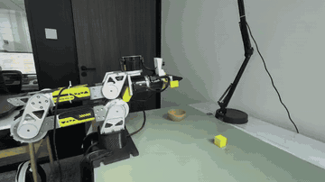
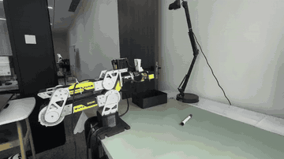
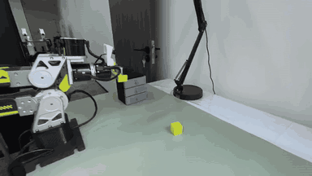

# FastWAM：LIBERO、RoboTwin 与 ReBot

[English](README.md) · [▶ 视频展厅](https://juxingyiwan.github.io/fastwam/) · [上游 FastWAM](https://github.com/yuantianyuan01/FastWAM) · [贡献指南](CONTRIBUTING.zh-CN.md) · [全部 CI 检查](https://github.com/juxingyiwan/fastwam/actions)

[](https://github.com/juxingyiwan/fastwam/actions/workflows/cpu.yml)

**训练 FastWAM 策略，在仿真中评估，并部署到 ReBot / B601 真机。**

提交工程基于上游 `7faa71108368fbb3b6885649f112af607427a2d4` 和已审计的部署源码。模型、控制、回零和 RTC 实现保留；机器专用编排与生成产物放在工程外。来源及源码指纹见 [SOURCE_PROVENANCE.json](SOURCE_PROVENANCE.json)。

[开始使用](#workflows) · [真机演示](#rebot-demos) · [开发与来源](#development)

<a id="rebot-demos"></a>

## ReBot / B601：FastWAM RTC 真机演示

以下为 **开启 RTC** 的三项真机任务演示：方块入碗、笔入盒，以及打开上层抽屉并放入方块。下方无声动图按原速展示每段完整演示，表头保留完整任务指令。点击动图可播放原始 720p 视频，支持声音和全屏控制。

[▶ 视频展厅](https://juxingyiwan.github.io/fastwam/)

| `Grasp the cube to the bowl` | `Grasp the pen to the box` | `Grasp the cube into the closed top drawer` |
| --- | --- | --- |
| [](https://juxingyiwan.github.io/fastwam/#cube) | [](https://juxingyiwan.github.io/fastwam/#pen) | [](https://juxingyiwan.github.io/fastwam/#drawer) |
| [▶ 播放视频 · 18.7 秒](https://juxingyiwan.github.io/fastwam/#cube) | [▶ 播放视频 · 11.4 秒](https://juxingyiwan.github.io/fastwam/#pen) | [▶ 播放视频 · 17.4 秒](https://juxingyiwan.github.io/fastwam/#drawer) |

[真机部署指南](docs/rebot.zh-CN.md) · [视频信息](assets/demos/manifest.json)

<a id="workflows"></a>

## 按场景开始

| 目标 | 文档 | 主入口 |
| --- | --- | --- |
| LIBERO 训练与评测 | [中文](docs/libero.zh-CN.md) · [English](docs/libero.md) | `experiments/libero/run_libero_manager.py` |
| RoboTwin 训练与评测 | [中文](docs/robotwin.zh-CN.md) · [English](docs/robotwin.md) | `experiments/robotwin/run_robotwin_manager.py` |
| B601 数据、训练与部署 | [中文](docs/rebot.zh-CN.md) · [English](docs/rebot.md) | `experiments/b601/local.sh` |
| 环境选择 | [环境配置](environments/README.md) | 训练、真机与 CPU 测试分别管理 |

命令均从 checkout 根目录运行。模型、数据、仿真资产、设备标识及校准配置需要另行准备；GPU 训练和推理需要合适的 Linux/CUDA 环境。

```bash
git rev-parse HEAD
export PYTHONPATH="$PWD/src:$PWD${PYTHONPATH:+:$PYTHONPATH}"
```

## 目录职责

| 路径 | 内容 |
| --- | --- |
| `src/fastwam/` | 模型、训练器、数据集、EE-delta 与 RTC 张量计算 |
| `experiments/b601/` | 真机适配器、模型导出、本地入口、无硬件测试 |
| `experiments/libero/` | LIBERO 入口与可选 visual-only TTT |
| `experiments/robotwin/` | RoboTwin 入口与策略适配器 |
| `configs/`、`scripts/` | 公开配置、训练和数据处理入口 |
| `third_party/RoboTwin/` | 仿真源码；大体积资产单独安装 |
| `docs/`、`environments/` | 场景指南和分离的环境说明 |

## 真机约定

动作包含基坐标系平移增量、旋转向量和一个夹爪通道，共七维；每一步基于新反馈解码。默认同步执行，RTC 需要显式开启。详见[数据约定](experiments/b601/docs/data.md)、[配置模板](experiments/b601/configs/local.example.yml)及[回零实现说明](experiments/b601/NATIVE_HOMING.md)。

先检查 `models`、`config`，再使用兼容模型包进行离线 `check`。硬件预检和真机运行应在有人看护的现场进行。CPU 测试不等同于真机轨迹或任务成功率验证。

<a id="development"></a>

## 开发与来源

```bash
python scripts/check_submission.py
CUDA_VISIBLE_DEVICES='' PYTHONPATH="$PWD/src:$PWD" \
  python -m pytest -q experiments/b601/tests experiments/libero/visual_ttt
```

检查步骤见[贡献说明](CONTRIBUTING.zh-CN.md)、[CI 定义](.github/workflows/cpu.yml)和[实际验证记录](docs/validation.md)。本次源码整理不新增 benchmark 分数或真机成功率声明。

上游文档原样保存在 [README.upstream.md](README.upstream.md) 和 [README.upstream.zh-CN.md](README.upstream.zh-CN.md)。文档组织参考 [juxingyiwan/wall-x](https://github.com/juxingyiwan/wall-x/tree/2625a5bcf6066c873853bf9554b1041157d0f65c)。

FastWAM 保留 [MIT 许可](LICENSE)，B601 适配运行时保留 [Apache-2.0 许可](experiments/b601/runtime/LICENSE)。第三方代码沿用各自许可和版权头，见 [NOTICE.txt](NOTICE.txt)。
